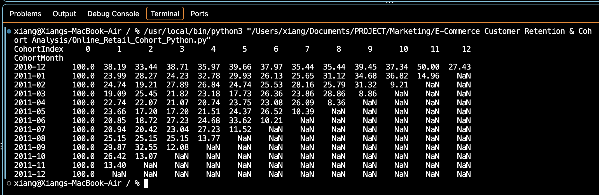

# 📊 E-Commerce Customer Retention & Cohort Analysis

Monthly cohort retention analysis of the UCI Online Retail dataset (Dec 2010 – Dec 2011) using Python (Pandas) and Excel.

## 🚀 Workflow
1. Removed rows with missing `CustomerID`, cancelled invoices (`InvoiceNo` starting with `C`) and rows with non-positive Quantity or UnitPrice
2. Extracted `InvoiceMonth` and each customer's first purchase month (`CohortMonth`)
3. Calculated `CohortIndex` (months since first purchase)
4. Counted unique active customers per cohort and month
5. Converted counts to retention % relative to cohort size

## 📈 Results

## 💡 Key Insights
- **Largest drop-off is after month 0:** only about 11–37% of customers return in the following month, depending on the cohort.
- **The Dec 2010 cohort retains best (about 27–50%)** because it likely includes existing customers who were already buying before the data starts, so it should not be read as a pure new-customer cohort.
- **Retention is similar across the 2011 cohorts:** roughly 15–25% in month 1, with no clear improvement over time.
- **Final-month values are understated:** the dataset ends on 9 Dec 2011, so the last value of each cohort (e.g. 7–12%) reflects an incomplete month, not real churn.

## 📁 Files
- `Online_Retail_Cohort_Python.py`: analysis code
- `online_retail_dataset_cohort.xlsx`: input data
- `Retention_Matrix_Python.xlsx`: output
- `retention_matrix.png`: result screenshot

## 🛠️ Built With
Python (Pandas), Microsoft Excel
